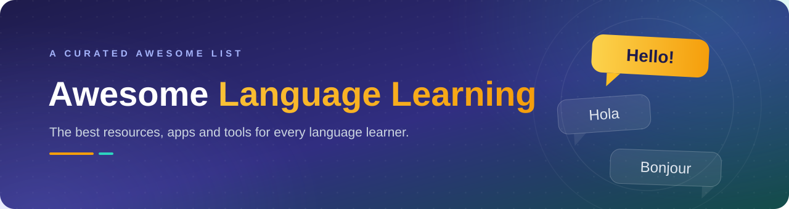

  
   
  
  
  

  A community-driven list of awesome websites, apps, resources and tools for language learning. 
  From absolute beginners to seasoned polyglots, organized by level, skill and language.

---

## Contents

- [General Resources](#general-resources)
  - [General Tools](#general-tools)
  - [Free Courses & Audio](#free-courses--audio)
  - [Language Learning Tips](#language-learning-tips)
  - [Communities](#communities)
- [Concepts](#concepts)
- [How to Learn a Language](#how-to-learn-a-language)
- [Languages](#languages)

---

## General Resources

### General Tools

- [Italki](https://www.italki.com/) - Find language tutors and native speaker partners.
- [Busuu](https://www.busuu.com/) - Language learning platform with 14 languages.
- [Memrise](https://www.memrise.com/) - Language learning platform with mnemonics and spaced repetition.
- [Recordar Palabras](https://recordarpalabras.com/) - Personal vocabulary review with short spaced repetitions, available on the web and iPhone in Spanish and English.
- [LingQ](https://www.lingq.com/) - Platform for learning through immersion.
- [Duolingo](https://www.duolingo.com/) - The most popular platform for language learning. Start learning a new language for free in an engaging, gamified way.
- [Anki](https://apps.ankiweb.net/) - Free spaced-repetition flashcard app, with shared decks for almost any language.
- [Forvo](https://forvo.com/) - Pronunciation dictionary with words recorded by native speakers.
- [Clozemaster](https://www.clozemaster.com/) - Learn vocabulary in context by filling in the missing word in thousands of sentences.
- [Language Reactor](https://www.languagereactor.com/) - Browser extension that adds dual subtitles and a pop-up dictionary to Netflix and YouTube.
- [HiNative](https://hinative.com/) - Ask native speakers quick questions about how their language is really used.
- [LangCorrect](https://langcorrect.com/) - Write in your target language and get free corrections from native speakers.

### Free Courses & Audio

- [Language Transfer](https://www.languagetransfer.org/) - Free audio courses that teach you to think in the language instead of memorizing rules.
- [FSI Language Courses](https://www.fsi-language-courses.org/) - Public domain courses originally developed for US diplomats, covering more than 40 languages.
- [50Languages](https://www.50languages.com/) - Free beginner courses with native audio in over 50 languages.
- [Coffee Break Languages](https://coffeebreaklanguages.com/) - Podcast lessons in short episodes that fit into a coffee break.
- [Easy Languages](https://www.easy-languages.org/) - Street interviews with dual subtitles, recorded in dozens of languages.

### Language Learning Tips

- [Steve Kaufmann](https://www.thelinguist.com/) - A polyglot who speaks more than 20 languages shares how to learn on your own. Founder of LingQ.
- [FluentU Blog](https://www.fluentu.com/blog/) - Tips and hacks for learning languages.
- [Luca Lampariello](https://www.lucalampariello.com/) - A blog and book on how to learn languages from a polyglot and mentor.
- [Fluent in 3 Months](https://www.fluentin3months.com/) - Blog by Benny Lewis, a polyglot who shares his language learning experiences.
- [Actual Fluency](https://actualfluency.com/) - Podcast in which Kris Broholm interviews polyglots and experts about how they learn.

### Communities

- [r/languagelearning](https://www.reddit.com/r/languagelearning/) - The largest online community of language learners, with an extensive FAQ and wiki.
- [WordReference Forums](https://forum.wordreference.com/) - Long-running forums for nuanced vocabulary and grammar questions in many language pairs.
- [Conversation Exchange](https://www.conversationexchange.com/) - Find partners for face-to-face, correspondence or chat language exchange.

---

## Concepts

- [Language Acquisition](https://en.wikipedia.org/wiki/Language_acquisition) - The process by which humans acquire the capacity to perceive and comprehend language, as well as to produce and use words and sentences to communicate. We recommend the talk from [Stephen Krashen on Language Acquisition](https://www.youtube.com/watch?v=NiTsduRreug).
- [Comprehensible Input](https://en.wikipedia.org/wiki/Input_hypothesis) - The hypothesis that we acquire language by understanding messages slightly above our current level. For a practical roadmap built on it, see [Refold](https://refold.la/).
- [Spaced Repetition](https://en.wikipedia.org/wiki/Spaced_repetition) - A learning technique that incorporates increasing intervals of time between subsequent review of previously learned material.
- [Immersion](https://en.wikipedia.org/wiki/Language_immersion) - A method of teaching a second language in which the learners' second language is the medium of instruction.
- [Language Exchange](https://en.wikipedia.org/wiki/Language_exchange) - A method of practicing a second language with native speakers of that language.
- [Mnemonics](https://en.wikipedia.org/wiki/Mnemonic) - Memory aids that help in the retention of information.

---

## How to Learn a Language

No single method fits everyone, but successful learners tend to follow the same pattern: plenty of understandable input, a little systematic review, and regular real use. Here is what that looks like in practice.

### The four habits that matter

1. **Get input you can understand.** Reading and listening you mostly understand is where [acquisition](#concepts) happens. Aim for content slightly above your level: graded readers, learner podcasts, videos with subtitles.
2. **Review vocabulary with [spaced repetition](#concepts).** A handful of words every day, reviewed just before you would forget them, compounds quickly. [Anki](https://apps.ankiweb.net/) or [Memrise](https://www.memrise.com/) handle the scheduling for you.
3. **Treat grammar as a reference, not a prerequisite.** Look up a rule when you keep bumping into it in your input. Grammar explains the language; it does not replace exposure to it.
4. **Use the language from week one.** Speak with tutors or [exchange partners](#concepts) on [Italki](https://www.italki.com/), [Tandem](https://www.tandem.net/) or [HelloTalk](https://www.hellotalk.com/), and write short texts for correction on [LangCorrect](https://langcorrect.com/). Output feels uncomfortable, and that is exactly why it works.

### A roadmap by stage

**Beginner (A0-A1).** Learn the sounds and writing system first, since bad pronunciation habits are hard to fix later. Build the 500 most common words and a set of survival phrases. Short daily app sessions are fine at this stage.

**Intermediate (A2-B1).** This is where most learners quit, because apps stop working and native content is still too hard. Bridge the gap with content made for learners: podcasts, graded readers and YouTube with subtitles. Start regular conversation practice, even if it is painful at first, and keep adding vocabulary from your own reading and listening.

**Advanced (B2-C2).** Live on native content: series, books, podcasts and news. Shadow native audio to polish your rhythm and pronunciation, write longer texts and get them corrected, and work deliberately on your weak spots: specialized vocabulary, fast speech, slang and humor.

### Common mistakes

- Waiting until you feel ready to speak. That day never comes on its own.
- Studying grammar for months without listening to or reading the language.
- Collecting apps and courses instead of doing the daily work.
- Binge studying on weekends instead of short daily sessions. Fifteen focused minutes a day beats three hours on Sunday.

Once you have the habits, pick your language below and dive into the resources for your level.

---

## Languages

Each language has its own folder with resources organized by skill and CEFR level.

- [Arabic](languages/arabic/)
- [Dutch](languages/dutch/)
- [English](languages/english/)
- [French](languages/french/)
- [German](languages/german/)
- [Hindi](languages/hindi/)
- [Italian](languages/italian/)
- [Japanese](languages/japanese/)
- [Korean](languages/korean/)
- [Mandarin Chinese](languages/mandarin-chinese/)
- [Portuguese](languages/portuguese/)
- [Russian](languages/russian/)
- [Spanish](languages/spanish/)
- [Turkish](languages/turkish/)

Is your language missing? [Open a pull request](CONTRIBUTING.md) and add it.

---

## Contributing

Sharing, suggestions and contributions are always welcome. If you know a resource that belongs here, please read the [contribution guidelines](CONTRIBUTING.md) and open a pull request.

Thanks to all contributors, you're awesome and this wouldn't be possible without you!

## License

This work is dedicated to the public domain under [CC0 1.0](LICENSE).
